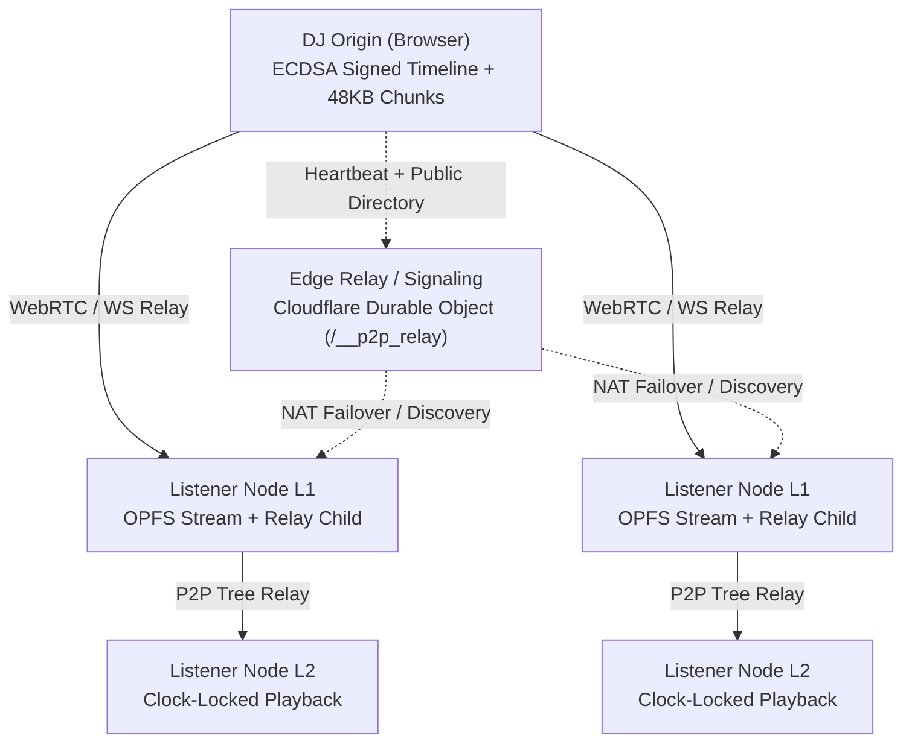

<div align="center">


# BRAINDANCE // RADIO

**Decentralized, clock-synchronized P2P internet radio.**

Stream lossless FLAC or MP3 tracks directly from your browser across a self-healing WebRTC + WebSocket relay pyramid mesh with zero cloud audio storage.

[](https://braindance.tallgeese.workers.dev)
[](https://svelte.dev/)
[](https://www.typescriptlang.org/)
[](https://developers.cloudflare.com/durable-objects/)

**[Launch Live Demo](https://braindance.tallgeese.workers.dev)** · [Architecture](#architecture) · [Features](#features) · [Local Development](#local-development) · [Deploy](#deploy-to-cloudflare-workers)

</div>

---

## Overview

In **BRAINDANCE // RADIO**, the broadcaster's browser acts as the broadcast origin. Tracks are split into `48 KB` chunks, verified with SHA-256 digests, and distributed through a dynamic tree of connected listeners (`PeerJS` WebRTC with transparent fallback to a Cloudflare Durable Object WebSocket relay on `/__p2p_relay`).

No audio files are uploaded to a central media server — peers relay chunks downstream to other listeners while streaming straight to browser **OPFS** (Origin Private File System) disk storage.

## Live Demo

> **[https://braindance.tallgeese.workers.dev](https://braindance.tallgeese.workers.dev)**

- **Host a Station (DJ):** Drop `.flac` or `.mp3` files, choose a callsign (publicly listed or unlisted private), optionally auto-transcode to `128kbps` MP3 in a background Web Worker, and start broadcasting.
- **Tune In (Listener):** Pick an active broadcast from the live public stations directory or enter any station callsign / invite link.

## Features

- **Hybrid WebRTC + WebSocket Relay Mesh ([`p2p-mesh.ts`](src/lib/p2p-mesh.ts)):** Establishes direct peer-to-peer WebRTC data channels via PeerJS and automatically bridges strict NATs/firewalls through the edge `/__p2p_relay` WebSocket tunnel with auto-healing parent failover.
- **Clock-Locked Synchronized Playback ([`time-sync.ts`](src/lib/time-sync.ts), [`player-controller.ts`](src/lib/player-controller.ts)):** Computes network clock offset against the broadcast origin so all listeners stay synchronized within tight drift tolerances, pre-buffering the upcoming track cleanly.
- **Zero-Copy OPFS Disk Streaming ([`audio-storage.ts`](src/lib/audio-storage.ts), [`chunk-pipeline.ts`](src/lib/chunk-pipeline.ts)):** Streams incoming audio chunks directly to OPFS (`track_<id>.bin`) with Cache Storage API fallback instead of holding large lossless files in JS heap memory.
- **Client-Side MP3 Transcoding ([`audio-encoder.ts`](src/lib/audio-encoder.ts)):** Optional Web Worker encoding (`@breezystack/lamejs`) compresses ~25 MB FLAC tracks down to ~2 MB `128kbps` MP3 streams to cut peer relay bandwidth ~90%.
- **Cryptographic Origin & Chunk Verification:** Signs `StationState` broadcasts with ECDSA (`P-256` / `SHA-256`), validates per-chunk SHA-256 digests to drop forged/corrupted chunks, enforces host ownership tokens, and gates Co-DJ track injection behind invite secrets.
- **Live Telemetry & Audio Visualizers:** Real-time topology graph ([`PyramidTree.svelte`](src/lib/PyramidTree.svelte)), audio-reactive spectrum visualizers ([`EvaTimer.svelte`](src/lib/EvaTimer.svelte)), and buffer telemetry ([`EvaBufferAnalysis.svelte`](src/lib/EvaBufferAnalysis.svelte)), styled after the Evangelion NERV interface.
- **Offline-Ready PWA ([`sw.js`](public/sw.js), [`manifest.webmanifest`](public/manifest.webmanifest)):** Versioned service worker shell pre-caching with automatic commit-tagged cache rotation on build.

## Architecture



## Project Structure

```text
p2p-radio/
├── public/                  # SVG/PNG icons, PWA manifest, fonts, and Service Worker (sw.js)
├── src/
│   ├── App.svelte           # Main application shell, DJ/Listener views, and telemetry
│   └── lib/
│       ├── p2p-mesh.ts      # Self-healing WebRTC + WebSocket relay tree, ECDSA/token auth
│       ├── player-controller.ts # Clock-locked HTMLAudio + WebAudio playback & track transitions
│       ├── chunk-pipeline.ts # 48KB chunking, SHA-256 digests, OPFS TrackBuffer
│       ├── audio-storage.ts # OPFS streaming writer + Cache API fallback
│       ├── audio-cache.ts   # Persistent disk cache wrapper
│       ├── audio-encoder.ts # Web Worker 128kbps MP3 transcoder (@breezystack/lamejs)
│       ├── audio-metadata.ts# FLAC/ID3 metadata & embedded cover art parser
│       ├── time-sync.ts     # Origin clock offset estimator
│       └── *.svelte         # UI components (PyramidTree, EvaTimer, EvaBufferAnalysis, etc.)
├── worker/
│   └── relay-worker.ts      # Cloudflare Worker + P2PRelayDO Durable Object (/__p2p_relay)
├── vite-relay-plugin.ts     # Local Vite dev relay & directory server plugin
├── vite.config.ts           # Build config, version/commit injection, SW cache stamping
└── wrangler.jsonc           # Cloudflare Workers deployment config
```

## Local Development

**Prerequisites:** Node.js `20+` and `npm`.

```bash
# Install dependencies
npm install

# Start Vite dev server (includes local /__p2p_relay WebSocket & station directory plugin)
npm run dev
```

Type-check and verify production bundle:

```bash
npm run check
npm run build
```

> **Local tunnel testing:** `vite.config.ts` binds `host: true`, so you can expose your dev server to phones or remote listeners via Cloudflare Tunnel / ngrok and test WebRTC + WebSocket fallback immediately.

## Deploy to Cloudflare Workers

Deployment targets the `braindance` Worker + `P2PRelayDO` Durable Object defined in [`wrangler.jsonc`](wrangler.jsonc):

```bash
# Authenticate once with Cloudflare if needed
npx wrangler login

# Build static assets + deploy Worker & Durable Objects
npm run deploy
```

Or run the Durable Object relay locally via Wrangler:

```bash
npm run build
npx wrangler dev
```
